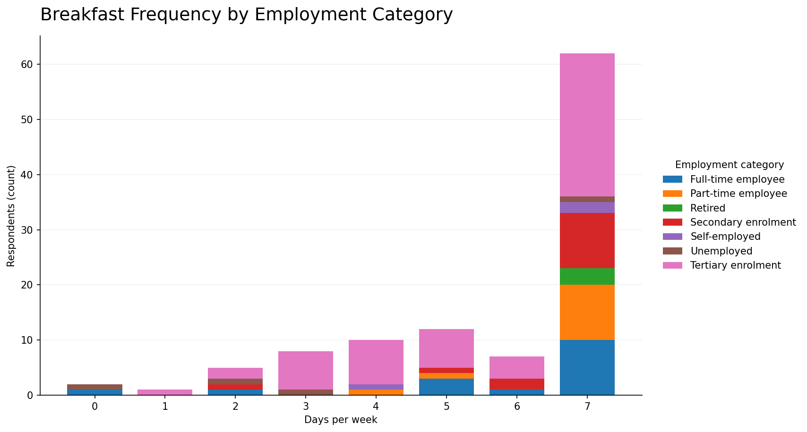
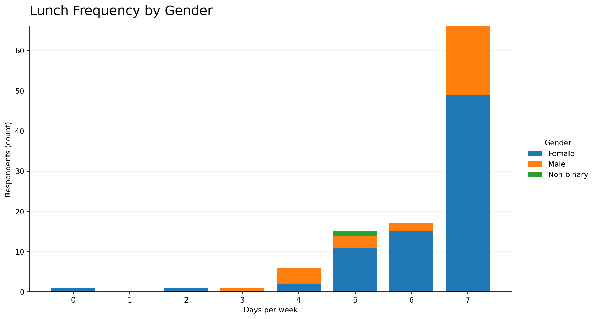

# Dietary Habits Survey Analysis

**Exploratory data analysis · R · ggplot2 · R Markdown · GitHub Actions**

A portfolio project exploring how dietary routines differ across respondent groups. It uses an observational survey of **107 responses and 19 variables** and presents two complementary analyses: breakfast frequency by employment category and lunch frequency by gender.

The underlying dataset was provided for analysis, not collected by this repository. No respondent-level records are published. Findings are **descriptive** and do not demonstrate causal relationships.

## Visualisations

### Breakfast frequency by employment category



**62 / 107 (57.9%)** reported eating breakfast on all seven days of a typical week.

[Explore the standalone breakfast report](breakfast_report.html) · [View the R Markdown source](breakfast_frequency.Rmd)

### Lunch frequency by gender



**66 / 107 (61.7%)** reported eating lunch on all seven days. Gender-group sizes are uneven, so the stacked segments should not be interpreted as within-group rates.

[Explore the standalone lunch report](lunch_report.html) · [View the R Markdown source](lunch_frequency.Rmd)

## Technical implementation

- **R / ggplot2:** categorical distributions, stacked bar charts and respondent-count summaries.
- **R Markdown / Pandoc:** reproducible source documents for local HTML generation.
- **R data checks:** missing values, valid day ranges, category consistency and benchmark totals.
- **Python / GitHub Actions:** automated checks for required files, aggregate-only public content and inadvertent dataset uploads.

## Repository structure

```text
.
├── README.md
├── breakfast_frequency.Rmd
├── lunch_frequency.Rmd
├── breakfast_report.html
├── lunch_report.html
├── assets/
│   ├── breakfast_frequency.png
│   └── lunch_frequency.png
├── docs/
│   ├── METHODOLOGY.md
│   ├── REPRODUCIBILITY.md
│   └── PORTFOLIO_SUMMARY.md
├── qa/
│   ├── check_breakfast.R
│   ├── check_lunch.R
│   └── check_repository.py
├── .github/workflows/quality-checks.yml
└── .gitignore
```

## Run locally

You need R, the `ggplot2` and `rmarkdown` packages, Pandoc, and an **authorised local copy** of the source dataset. Save that private copy as `survey_data.csv` next to the `.Rmd` files; do not commit or upload it.

```powershell
Rscript -e "install.packages(c('ggplot2','rmarkdown'), repos='https://cloud.r-project.org')"
Rscript qa/check_breakfast.R
Rscript qa/check_lunch.R
Rscript -e "rmarkdown::render('breakfast_frequency.Rmd')"
Rscript -e "rmarkdown::render('lunch_frequency.Rmd')"
python qa/check_repository.py
```

The generated `breakfast_frequency.html` and `lunch_frequency.html` are **local runtime outputs**. The published `breakfast_report.html` and `lunch_report.html` are separately prepared, aggregate-only static previews using verified chart counts. They are not represented as direct renders from the distributed source documents.

## Interpretation and privacy

The graphs show **counts**, not group-normalised percentages. Uneven group sizes limit direct comparisons. A small category has just one respondent, so disclosure and interpretation require particular care.

The dataset is excluded from the repository, and the public charts contain only aggregated information. Distribution of these derivative charts should still comply with the dataset owner's permissions. Automated repository checks reduce common errors but are not a substitute for a complete disclosure review.

For analysis details and reproducibility limits, see [methodology](docs/METHODOLOGY.md) and [reproducibility notes](docs/REPRODUCIBILITY.md).
